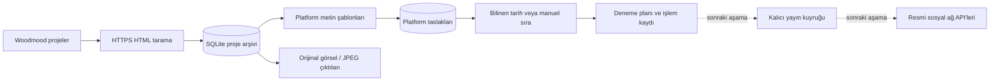

# Mimari ve sınırlar

Uygulanan bölüm: kaynak tarama, katalog, metin/görsel hazırlama, yerel panel, deneme planı ve tarama worker'ı. Kesikli okların gösterdiği kuyruk ve gerçek yayın API'leri bu sürümde bulunmaz.

## Veri davranışı

`projects.url` benzersiz kaynak kimliğidir. Başlık, açıklama, galeri ve varsa yayın tarihi SHA-256 özetiyle değişiklik açısından izlenir. Aynı içerikle tekrar tarama projeyi ve taslağı çoğaltmaz. Silinen projeler otomatik olarak veri tabanından çıkarılmaz. Kaynak taraması, tüm liste ve detay sayfaları başarıyla çözümlenmeden katalog değişikliği uygulamaz.

`drafts(project_id, platform)` benzersizdir. Durumları `draft`, `ready`, `scheduled` (yalnızca deneme) olur. `published` durumu yoktur. Kaynak değiştiğinde mevcut metin korunur; taslak ve plan etkinliği sıfırlanır. Yeniden üretim açıkça çağrılana kadar değişiklik işaretli kalır. Bu, tam otomatik akışta da ilk sürümün istisna davranışıdır; ileride marka politikasıyla kontrollü otomatik yenileme eklenebilir.

Deneme planı oluşturma SQLite yazma kilidi altında atomiktir. Hatalı bir proje hiçbir kısmî plan bırakmaz; iki eşzamanlı planlayıcı aynı projeyi ekleyemez. Var olan plana ekleme sonraki zaman diliminden başlamalıdır. Plan iptali, metinleri korur. Eski plan JSON'u geçmiş kaydı olarak kalır; aktif plan her zaman taslakların güncel durumundan okunur.

Tüm bekleyen projelerin güvenilir tarihleri varsa tarih sırası kullanılır. Tarihler eksikse tüm bekleyen projelere benzersiz manuel sıra verilmelidir. Tarih ve kısmi manuel sıra karışımından kendiliğinden tarih tahmini yapılmaz. Sitedeki yayın tarihi ile projenin tamamlanma tarihi farklı olabilir; işletmenin verdiği manuel sıra önceliklidir.

## Kaynak ve görseller

Alan adı izinleri yalnızca konfigürasyonda tanımlanan HTTPS kaynaklarına erişime izin verir. Kimlik bilgisi içeren URL'ler ve farklı alan adına yönlendirmeler reddedilir. TLS doğrulaması kapatılmaz. Yanıt ve görsel boyutu sınırlandırılmıştır. Canlı sitede proje açılışı ve `.detay-galeri` bağlantıları kullanılır; `srcset` varsa orijinal büyük görsel seçilir. Önerilen diğer proje kartları arşiv görsellerine katılmaz.

Görseller JPEG'e çevrilir, EXIF yönü uygulanır, alfa kanalı nötr zemine düzleştirilir. Tam görüntü hedef tuvale sığdırılır; ürün kenarlarını kesen otomatik kırpma yapılmaz. Başlangıç ölçüleri Instagram 1080×1350, Facebook 1200×630, LinkedIn 1200×1200'dür. Bunlar içerik hazırlama tercihidir; tüm platform biçimleri veya resmi API kabulü için yeterlilik iddiası değildir.

## Üretim için eksikler

Bu bir tek sunuculu geliştirme altyapısıdır. OAuth, medya barındırma, gerçek gönderi kimlikleri, platform callback'leri, oran sınırları, tekrar deneme kuyruğu, üretim paneli kimlik doğrulaması, metrikler ve yedekleme sonraki aşamadadır. Bir `worker` süreci siteyi periyodik tarar; sosyal ağ gönderimi gerçekleştirmez. Yeniden başlatma anında in-flight taramalar için çoklu worker koordinasyonu henüz yoktur; tek tarama worker'ı kullanılır.
